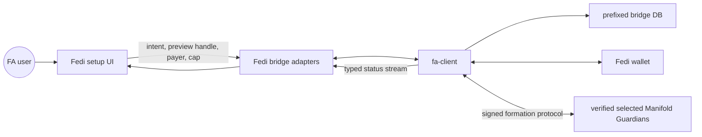
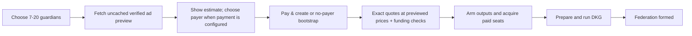

# Fedi app Federation Ambassador integration

## Purpose and current scope

The Fedi app is the primary consumer of
[`fa-client`](../../crates/fa-client/specs/ARCH-fa-client.md). The bridge gives
the library a root-derived FA identity, an isolated database namespace, an
Iroh adapter, and a typed RPC surface. The front end supplies formation intent,
presents the library's verified advertisement preview, selects one eligible
joined payer, and invokes Pay-and-create. `fa-client` owns the guardian set,
exact quotes, payment boundary, and formation transitions.

The formation contract includes registry discovery, automatic verified
operator selection, and wallet-backed payment RPCs. Fedi UI implementation is
owned separately. Post-formation management, liquidity, and fee arrangement
remain separate capabilities rather than app-side state machines.

## Ownership boundary

| Concern | Fedi owns | `fa-client` owns |
| --- | --- | --- |
| Identity | Derive and protect the stable FA key from the app root secret; sign requested digests | Construct every domain-separated protocol digest |
| Storage | Allocate a dedicated encrypted bridge database prefix | Define and update formation recovery records |
| Payments | Project joined/balance state, pay one exact quote at a time, recover exact wallet operations by quote, settle refunds | Authenticate admitted payers, verify quote terms, and order seat payments |
| Transport | Bind and reuse an Iroh endpoint | Drive `ManifoldGuardianService` and verify manager commitments against each locator |
| UI | Collect intent, render the uncached preview and eligible joined wallets, return the sealed handle/payer | Verify all seats, select operators, validate input, resolve defaults, and own lifecycle transitions |

The bridge converts types and capabilities; it does not implement a second
formation state machine. The front end cannot mark registry data as trusted,
construct protocol transitions, or advance formation by submitting a synthetic
status.

## Intent collected by the app

The setup surface collects only the current `FormationIntent` fields:

- an optional federation display name;
- a federation size from the app's presets 7/10/13 (10 is the default and
  recommended preset) or custom inclusive range 7 through 20;
- the plan family, of which `InfiniteBestEffort` is currently the only one; and
- the canonical supported fedimintd version.

If the user leaves the name blank, `fa-client` generates a two-word name. The
resolved value is persisted and returned in active status, so the UI displays
one stable name across restart. The app does not collect per-seat DKG labels or
custom ceremony configuration.

## User flow

Preview is advertisement-only and valid for five minutes from completion of its
verified walk. It binds the exact request, each seat's advertised price, and
the canonical verifier environment, and it is the user's payment approval. The
bridge keeps the non-serializable preview behind an opaque transient handle;
back-out, restart, or re-entry discards it and refetches. No `GetQuote` is sent
until the Pay-and-create command supplies that handle and an explicit
authenticated Ready payer. Each quote requests exactly the seat's previewed
plan, so the user pays exactly the previewed total. A deployment with no
setup-payment policy instead uses the explicit no-payer bootstrap command with
the same handle and requests only free quotes: a priced live offer returns typed
`PaymentFederationRequired` reauthorization before its quote or any wallet,
presentation, or output effect.

Before wallet output generation, stale or drifted terms, a changed price, payer failure,
or selected-seat unavailability return a typed reauthorization error and
a request for a new preview. If a crash interrupts cleanup, the run loop recognizes the explicit
selected-flow record, exposes no second-authorization action before outputs,
and either
continues a still-live preview or completes cleanup. The same still-live preview may retry another payer.
After outputs, an exact rejected or refunded seat leaves the purchase;
accepted, paid, prepared, and ambiguous siblings stay. The purchase completes
with the remaining seats, and a new purchase with a fresh preview buys any
missing seat. A definite MG
connection failure is retried with bounded exponential backoff for up to two
minutes (clipped by the invocation deadline) before that result. Once outputs
are armed the operation is non-abandonable and transport failure stays on exact
replay rather than suggesting replacement; recovery continues after crash.

## Bridge API shape

The bridge exposes four concepts:

- current FA service health plus the typed `FaState`;
- an uncached verified preview command returning display DTOs plus an opaque
  five-minute handle;
- authenticated admitted payer IDs (including zero-balance wallets), and a
  `create_federation` command with an explicit payer or no payer for the
  all-zero bootstrap; and
- a stream of typed status snapshots.

`FaState::Idle` means no creation and no federation. A creation always carries
its name, size, pool, and stage. The front end does not reconstruct
these values from nullable fields.

The active phase is one of `Preparing`,
`AcquiringSeats`, `PreparingDkg`, `DkgUnderway`, `PublishingSeatBindings`, or
`Formed`. Immediate command
failures and the snapshot's last operation error use stable typed categories;
UI behavior must not parse human-readable Rust error strings.

The ordinary `FedimintBridge` TypeScript wrapper owns stream identifiers and
cancellation, just like other bridge subscriptions. Components use that typed
wrapper rather than calling generated raw RPC names or managing stream ids
themselves.

## Payment adapter

`fa-client` buys seats one at a time and gives the wallet one verified quote
at a time. The Fedi wallet adapter:

1. reports which authenticated policy members are joined and Ready, while the
   admitted listing remains able to render a zero-balance refill choice;
2. recovers the operation for an exact quote without creating wallet state,
   and reports `NotStarted`, `Prepared`, or `Rejected`;
3. under the wallet-wide spend guard, checks that the balance covers the
   quote's current net cost after wallet fees, and reports typed insufficient
   funds only when it does not and no operation for the quote exists;
4. atomically persists the deterministic quote-bound operation and its
   recovery metadata before value commits, so a crash recovers that operation
   without another spend;
5. returns `Prepared` protocol payment evidence only after consensus accepts
   the exact transaction and payer change is spendable; and
6. settles an MG-signed refund retry-safely.

The preview is the payment approval: every quote has exactly the previewed
price. A wallet operation never authorizes another quote. A bridge that held
funds for an earlier aggregate reservation must release every unstarted hold
once, before it opens the FA. Started payments stay recoverable by quote.

Payment signatures, raw bearer ecash, refund secrets, and root-derived private
material do not enter FA storage, RPC status, analytics, or logs. The bridge can
be interrupted after a wallet or remote effect without losing correctness:
reopening the same wallet and FA database and resuming reconstructs the exact
operation.

## Progress and interruption

The bridge spawns `FaClient::run` once after open. Commands save their input
and return. The state stream is independent of that loop. The UI subscribes
when it needs live updates and can always query current state after
reconnecting. Stopping the loop stops local work but cannot roll back a wallet
transaction or remote request that already completed. The next run continues
from durable state.

A seat that cannot be bought leaves the purchase with a typed reason, for
example a changed price, an unavailable MG or payer, or insufficient funds.
The purchase completes with the seats it bought, and the state then asks for a
new preview of the missing seats. A seat with a started payment stays in the
purchase, and the run loop recovers it by quote.

Reloaded service-derived state is marked unsynced until reconciliation. An
already formed federation is verified through fresh guardian consensus; if its
saved invite is unreachable, recovery may ask saved managers for alternatives.
Unfinished formation retains its MG checks. The UI may display reloaded state
as last known information but must not present it as a fresh remote observation.

## Testing responsibilities

Bridge tests keep every library enum conversion exhaustive and verify the
database namespace and stable FA identity. RPC tests cover typed command errors,
idle and active status, and stream registration/cancellation. TypeScript tests
cover the normal `FedimintBridge` methods so application code never depends on
raw generated RPC details.

The app integration does not duplicate protocol E2E coverage. Manifold's
`defe` suite covers a seven-MG free formation and a separate seven-MG real
payment formation. Focused Manifold wallet tests cover recovery and refund
replay. Fedi-side tests focus on the consumer boundary,
including backgrounding or cancellation followed by state reload and a new run.

## Deferred product work

- post-formation management;
- liquidity and fee-arrangement workflows; and
- product analytics for formation completion.

Each deferred capability should arrive first as a `fa-client` state or port
extension, followed by a thin bridge mapping and UI.
